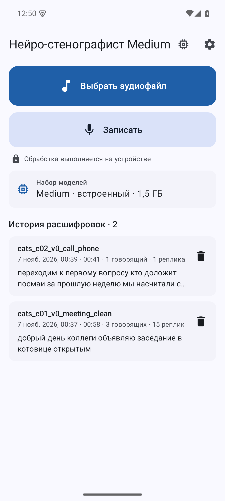
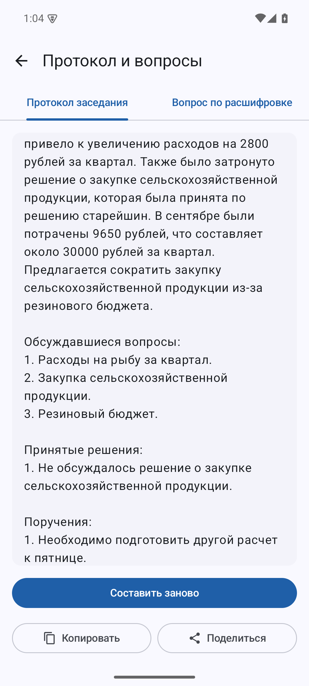
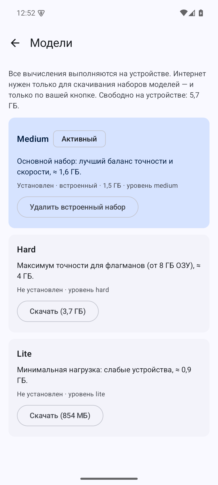
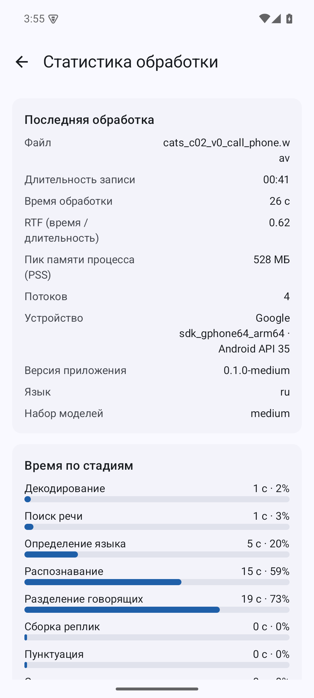

# Нейро-стенографист

Android-приложение, которое **полностью офлайн** расшифровывает записи разговоров: русская и английская речь,
разделение говорящих, временные метки, локальная LLM («Протокол заседания», вопросы по расшифровке), просмотр
с плеером, правка и экспорт JSON строго по ТЗ. Кейс «Нейро-стенографист», Nuclear IT Hack.

## Возможности

- Импорт аудио (wav, mp3, m4a и другие форматы, которые декодирует Android) или запись с микрофона; обработка стартует сама, работает в режиме полёта.
- ASR GigaAM v3 (русский, со знаками и регистром) + Parakeet (английский), автоопределение языка по фрагментам.
- Диаризация (pyannote-3.0 + эмбеддинги), реплики с `speaker_N` и метками `start_ms`/`end_ms`.
- Расшифровка с плеером: тап по реплике, подсветка, поиск, переименование говорящих, правка текста и говорящих.
- Экспорт: **JSON по ТЗ**, расширенный JSON (слова, время по стадиям), TXT, SRT, VTT.
- Локальная LLM (Qwen3, llama.cpp): протокол заседания и вопросы по тексту; статистика (RTF, память, стадии).
- Менеджер моделей: скачать другой набор, удалить встроенный, восстановить из APK. Интернет — только для него.

| | | | |
|---|---|---|---|
|  |  |  |  |

TODO(финал): заменить скриншоты расшифровки/плеера на снимки финальной сборки (текущие сняты до исправления паритета).

## Быстрый старт для жюри

1. Поставить **`neurosteno-medium-<версия>.apk`** (основной; модели внутри, интернет не нужен):
   `adb install -r artifacts/apk/neurosteno-medium-<версия>.apk` — подробнее `docs/INSTALL.md`.
   TODO(финал): положить итоговые APK в `artifacts/apk/` и указать версию/sha256.
2. Открыть приложение → **«Выбрать аудиофайл»** → выбрать запись. Обработка стартует сама, диалогов и разрешений нет.
3. На экране расшифровки → **«Экспорт JSON»** (файл по ТЗ через системный выбор места сохранения).
4. Без UI: результат автоматически сохраняется в
   `Android/data/ru.neurosteno.app.medium/files/results/<имя>.json` (+ `.full.json`, маркер `<имя>.done.json`);
   `adb pull` или `ACTION_VIEW`/`ACTION_SEND` с `audio/*` запускают обработку напрямую.

## Варианты APK

Один код, разные наборы моделей (подробно — `docs/MODELS.md`). Идентификатор: `ru.neurosteno.app.<вариант>`.

| APK | Назначение | Модели внутри | Пик RAM (цель) |
|---|---|---|---|
| **medium** | основной, для автопроверки | ASR+диаризация+LLM Qwen3-1.7B, ≈1,8 ГБ | обработка ≈0,5 ГБ; протокол ≈2,2 ГБ (устройство от 4 ГБ) |
| lite | слабые устройства | то же ядро, LLM Qwen3-0.6B, ≈0,9 ГБ | цель ≤ 1,0 ГБ |
| hard | флагманы | то же ядро, LLM Qwen3-4B, ≈3 ГБ | цель ≤ 4 ГБ (устройство от 8 ГБ) |
| online | UX-вариант: моделей нет, скачивает набор при первом запуске | — (скачивание) | как у выбранного набора |

В основной обработке LLM **не участвует**: знаки и регистр ставит ASR, LLM нужна только для протокола и вопросов (после сохранения JSON).
Пик памяти — замеры на эмуляторе jury-4g (`docs/TEST_RESULTS.md`). Размеры моделей — `docs/MODELS.md`, итоговые размеры APK: TODO(финал).

## Документы

| Файл | Что |
|---|---|
| `docs/INSTALL.md` | установка, использование, сборка из исходников, тесты |
| `docs/ARCHITECTURE_PUBLIC_DRAFT.md` | архитектура и принятые решения (чистовик) |
| `docs/MODELS.md` | модели, лицензии, почему выбраны |
| `docs/LIMITATIONS.md` | ограничения и риски |
| `docs/TEST_RESULTS.md` | методика и результаты тестов |
| `docs/DEFENSE.md` | материалы к защите |
| `artifacts/demo/` | видео (`README.md`), сценарий `VIDEO_SCRIPT.md`, скриншоты |

## Структура репозитория

| Путь | Что |
|---|---|
| `artifacts/` | `apk/` (сборки), `test-results/` (CSV и отчёты), `demo/` |
| `config/` | `tiers/*.json` (конфиги вариантов), `transcript.schema.json`, `models.json` |
| `docs/` | документация |
| `src/android/` | приложение (Kotlin, Compose; `core`, `audio`, `engine-sherpa`, `engine-llm`, `app`) |
| `src/eval/` | `stenoeval` (метрики), `refpipe` (эталонный пайплайн), `datasets`, `bench_asr` |
| `scripts/` | окружение, загрузка и раскладка моделей, сборка |

## Лицензии

Код проекта: TODO(финал) (лицензия не выбрана). Модели — открытые, под MIT / Apache-2.0 / CC-BY-4.0
(таблица с источниками — `docs/MODELS.md`); тексты лицензий лежат рядом с моделями внутри APK.
Тестовые данные собраны из открытых корпусов, их лицензии — `src/eval/datasets/README.md`.
