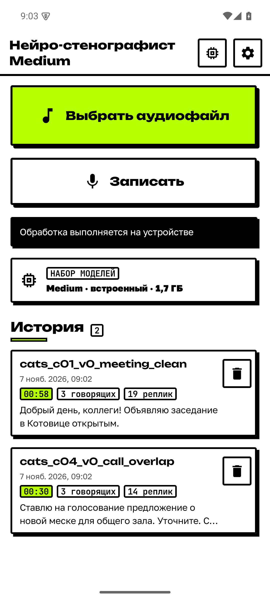
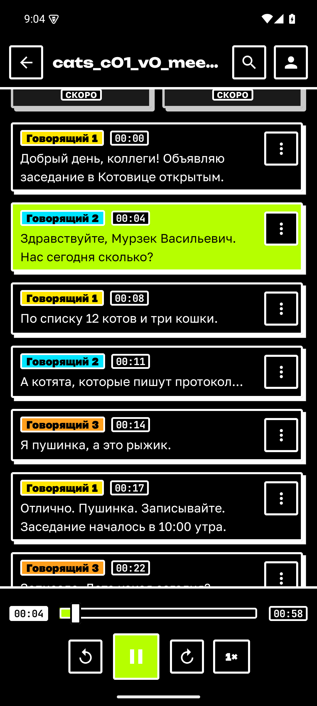
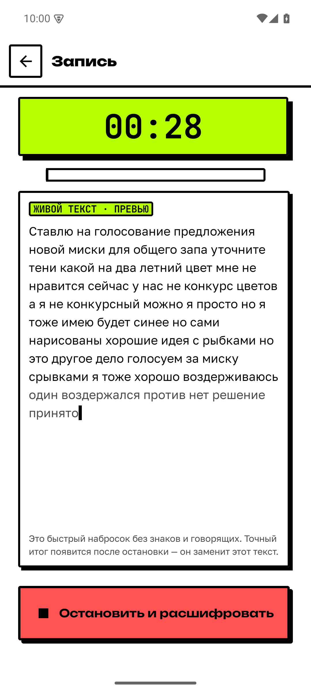
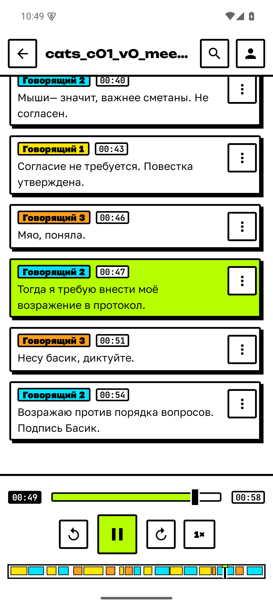
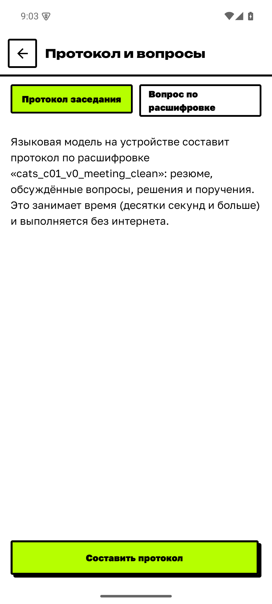
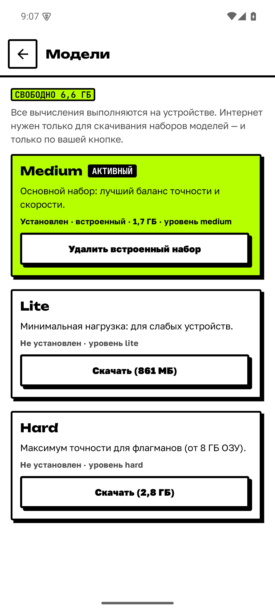

# Нейро-стенографист

Android-приложение, которое **полностью офлайн** расшифровывает записи разговоров: русская и английская речь,
разделение говорящих, временные метки, локальная LLM, просмотр с плеером, правка и экспорт JSON строго по ТЗ.
Кейс «Нейро-стенографист», Nuclear IT Hack.

| | | |
|---|---|---|
|  |  |  |
|  |  |  |

## Возможности

| Группа | Что есть |
|---|---|
| Распознавание | импорт аудио (форматы Android) или запись; русский (GigaAM v3 со знаками и регистром) и английский (Parakeet), язык определяется по фрагментам |
| Говорящие и метки | диаризация по фразам (эмбеддинг на фразу + кластеризация), `speaker_N`, `start_ms`/`end_ms`; дорожка говорящих под плеером |
| Просмотр и правка | плеер, подсветка и поиск, переименование, правка текста, повторная обработка выбранного фрагмента |
| Запись | живая расшифровка во время записи (быстрый набросок, итог — после остановки) |
| Экспорт | JSON по ТЗ, расширенный JSON, TXT, SRT, VTT, PDF (расшифровка + протокол) |
| LLM (Qwen3, llama.cpp) | протокол заседания, вопросы по расшифровке; выжимка по темам и AI-поиск по записям — TODO(финал): в работе |
| Модели | менеджер: скачать набор, удалить встроенный, восстановить; интернет — только для него |
| Дизайн | нео-брутализм, светлая и тёмная темы, альбомная ориентация, шрифт ×1,6 |

## Требования ТЗ: как закрыто

Цифры: ПК-эталон `refpipe`, medium, итоговая конфигурация, **test** (31 файл, синтетические диалоги), `artifacts/test-results/REPORT.md`; устройства и источники — `docs/TEST_RESULTS.md`.

**Базовый уровень**

| Пункт ТЗ | Как сделано | Цифра / доказательство |
|---|---|---|
| Работающий APK | 4 release-APK (lite/medium/hard/online), подписаны, офлайн | без падений на jury-2g/4g (B53); итоговые APK — TODO(финал) |
| Импорт аудиофайла | системный выбор файла, «Открыть с помощью»/«Поделиться», запись с микрофона | форматы Android (MediaCodec); автоматизация `ACTION_VIEW`/`SEND` |
| Локальная LLM | Qwen3 (0,6B / 1,7B / 4B), llama.cpp: протокол заседания и вопросы по записи | пик RSS 1,7B 2,71 → 1,64 ГБ с флагами памяти (B48) |
| Распознавание речи | GigaAM v3 RNNT (ru), Parakeet-110m (en), язык по чанкам | WER norm 21,4 % на диалогах test; 5,6–7,2 % на отдельных фразах (`docs/MODELS.md`) |
| Автоматическая диаризация | эмбеддинги по фразам + кластеризация | DER ±.25 11,3 %, число говорящих верно у 80,6 % файлов |
| Временные метки реплик | `start_ms`/`end_ms` по словам ASR | среднее отклонение начала реплики 256 мс, 77 % реплик точнее 300 мс |
| Отображение и экспорт результата | расшифровка с цветом говорящих, JSON по ТЗ, TXT, SRT, VTT, PDF | JSON проверяет `stenoeval validate` по схеме ТЗ |

**Средний уровень**

| Пункт ТЗ | Как сделано | Цифра / доказательство |
|---|---|---|
| Предобработка аудиосигнала | декодирование в моно 16 кГц, нормализация громкости для ASR | тихая запись −44 дБ: WER 35 → 13 % (`bench_asr/results/final/normalize_gain.md`) |
| Фильтрация пауз и неречевых фрагментов | Silero VAD + дозабор тихой речи, отбрасывание вывода ≤ 2 букв | телефонная запись: WER 42,5 → 32,9 % (B42); тишина и шумовой фон дают пустой вывод; на мяуканье и кашле остаются отдельные ложные слова (`bench_asr/results/robust.jsonl`) |
| Устойчивое определение участников при смене реплик | диаризация по фразам вместо кластеризации чанков | DER ±.25 24,0 → 11,7 %, число говорящих 42 → 77 % (до итоговой настройки); известны «флипы» числа (B57) |
| Восстановление пунктуации | знаки и регистр ставит сама ASR-модель | WER со знаками 30,8 % против 45,9 % у модели без знаков (synth, test) |
| Отображение прогресса обработки | проценты, оставшееся время, 7 стадий, «Отменить», уведомление | экран обработки (`screens/redesign/10_processing_light.png`) |
| Воспроизведение аудио с переходом к реплике | плеер ±10 с, скорость 0,75–2×, тап по реплике, подсветка текущей, дорожка говорящих | `screens/timeline-pdf/` |

**Ultra Pro Max**

| Пункт ТЗ | Как сделано | Цифра / доказательство |
|---|---|---|
| Фоновый шум и некачественные записи | VAD rescue, усиление только для ASR, `blank_penalty` 1,0 | test: noise WER 14,4 %, farfield 14,9 %, phone 23,4 %, reverb 34,5 % (слабое место); шумоподавление на дальнем поле не помогло (B55) |
| Короткие реплики и перебивания | VAD с низким порогом, реплики могут пересекаться по времени | **частично:** VAD теряет 3–12 % коротких «да/угу» (B31) |
| Одновременная речь нескольких участников | пересечения реплик допустимы в JSON | **частично:** ASR — один поток, слова смеси достаются одному говорящему; overlap: WER 26,0 %, DER ±.25 16,1 % |
| Устойчивость к различиям в тембре и манере речи | эмбеддинги говорящих 3D-Speaker (свои для каждого варианта), реальные дикторы в тестах | spk acc 80,6 % (66,7 % на телефоне); на реальных диалогах не проверено (B25) |
| Оптимизация оперативной памяти | модели грузятся по очереди, int8, флаги llama.cpp (без repack, KV q8_0), копирование моделей потоком | обработка ≈0,5 ГБ PSS; 30 мин записи — 935 МБ без OOM; первый запуск 1258 → 53 МБ (B53, B44) |
| Ускорение инференса аппаратными возможностями | **частично:** только CPU-оптимизации: int8, потоки, KV q8_0, без repack, `window_shift` 1,0 (сегментация ×10 быстрее) | release RTF 0,11–0,15 (lite, medium); GPU и NPU **не реализованы** (B38) |
| Редактирование и повторная обработка фрагментов | правка текста, смена и объединение говорящих, «Обработать заново» с языком и числом говорящих, отмена | 0,6–1,7 с на фрагмент (B37) |

## Сверх ТЗ

| Возможность | Статус | Как |
|---|---|---|
| Живая расшифровка при записи (B13) | готово | потоковая модель, RTF 0,055 на эмуляторе, выгружается до полной обработки |
| Дорожка говорящих и PDF (B54) | готово | нативный `PdfDocument`, офлайн, кириллица |
| Менеджер моделей (B5) | готово | скачать набор, удалить встроенный, восстановить; sha256, докачка |
| Редизайн (B52) | готово | нео-брутализм, акцент кислотно-зелёный (контраст 17,3:1), тёмная тема |
| Выжимка по темам (B50) | движок готов, экраны — TODO(финал) | LLM по фрагментам, ссылки на реплики проверяются |
| AI-поиск (B51) | в работе, TODO(финал) | гибрид BM25 + эмбеддинги, ответ LLM со ссылками |
| Английский и определение языка | готово | Parakeet-110m, WER 6,64 % на чтении (FLEURS en) |

## Быстрый старт для жюри

1. Поставить **`neurosteno-medium-<версия>.apk`** (основной; модели внутри, интернет не нужен):
   `adb install -r neurosteno-medium-<версия>.apk` — `docs/INSTALL.md`.
   TODO(финал): ссылка на APK (GitHub Release, B49), версия и sha256.
2. Открыть приложение → **«Выбрать аудиофайл»** → выбрать запись. Обработка стартует сама, диалогов и разрешений нет.
3. На экране расшифровки → **«Экспорт JSON»** (файл по ТЗ через системный выбор места сохранения).
4. Без UI: результат сохраняется сам в `Android/data/ru.neurosteno.app.medium/files/results/<имя>.json`
   (+ `.full.json`, маркер `<имя>.done.json`); `ACTION_VIEW`/`ACTION_SEND` с `audio/*` запускают обработку.

## Варианты APK

Один код, разные наборы моделей (`docs/MODELS.md`). Идентификатор: `ru.neurosteno.app.<вариант>`.

| APK | Назначение | Размер release (предрелиз, B53) | Что внутри |
|---|---|---|---|
| **medium** | основной, для автопроверки | 1,7 ГиБ | ASR, диаризация (ERes2Net-base), LLM Qwen3-1.7B |
| lite | слабые устройства | 935 МиБ | то же ядро, CAM++, LLM Qwen3-0.6B («черновой» протокол) |
| hard | флагманы (от 8 ГБ) | 2,9 ГиБ | то же ядро, ERes2Net v2, LLM Qwen3-4B |
| online | UX-вариант | 47 МиБ | моделей нет, скачивает набор при первом запуске |

В основной обработке LLM **не участвует**: знаки и регистр ставит ASR; LLM нужна для протокола, вопросов и выжимки после сохранения JSON.
Память: обработка ≈0,5 ГБ PSS, протокол на Qwen3-1.7B ≈1,6–2,2 ГБ (`docs/TEST_RESULTS.md`). Итоговые APK и sha256: TODO(финал).

## Документы

| Файл | Что |
|---|---|
| `docs/INSTALL.md` | установка, использование, сборка из исходников, тесты |
| `docs/ARCHITECTURE_PUBLIC_DRAFT.md` | архитектура и решения |
| `docs/MODELS.md` | модели, лицензии, почему выбраны |
| `docs/LIMITATIONS.md` | ограничения и риски |
| `docs/TEST_RESULTS.md` | методика и результаты тестов |
| `docs/DEFENSE.md` | материалы к защите |
| `artifacts/demo/` | видео, сценарий `VIDEO_SCRIPT.md`, скриншоты |

## Структура репозитория

| Путь | Что |
|---|---|
| `artifacts/` | `apk/`, `test-results/` (CSV и отчёты), `demo/` |
| `config/` | `tiers/*.json`, `transcript.schema.json`, `models.json` |
| `docs/` | документация |
| `src/android/` | приложение (Kotlin, Compose; `core`, `audio`, `engine-sherpa`, `engine-llm`, `app`) |
| `src/eval/` | `stenoeval` (метрики), `refpipe` (эталонный пайплайн), `datasets`, `bench_*` (бенчмарки ASR, диаризации, LLM, поиска) |
| `scripts/` | окружение, загрузка и раскладка моделей, сборка |

## Лицензии

Код проекта: TODO(финал) (лицензия не выбрана). Модели — открытые, MIT / Apache-2.0 / CC-BY-4.0 (`docs/MODELS.md`).
Векторная БД ObjectBox: API Apache-2.0, нативная библиотека закрытая (бесплатная), запасной путь без неё — перебор (`docs/LIMITATIONS.md`).
Тестовые данные собраны из открытых корпусов: `src/eval/datasets/README.md`.
